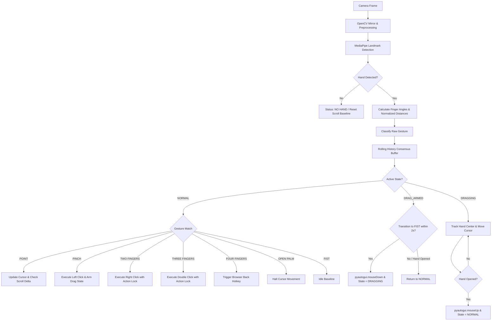

<div align="center">

# 🖐️ AeroClick

### **Touchless Mouse Control via Real-Time Computer Vision**

*Transform your standard webcam into an ultra-responsive, zero-contact mouse interface with intelligent gesture classification, transition locking, and jitter-free tracking.*

---

[](https://www.python.org/)
[](https://opencv.org/)
[](https://developers.google.com/mediapipe)
[](https://www.microsoft.com/windows)
[](#testing--verification)
[](#license)

</div>

---

## 📑 Table of Contents

- [Overview](#-overview)
- [Key Features](#-key-features)
- [Gesture Control Matrix](#-gesture-control-matrix)
- [System Architecture & Pipeline](#-system-architecture--pipeline)
- [Reliability & Conflict Protection](#-reliability--conflict-protection)
- [On-Screen Display (HUD)](#-on-screen-display-hud)
- [Configuration & Tuning Parameters](#-configuration--tuning-parameters)
- [Installation & Quickstart](#-installation--quickstart)
- [Usage & Controls](#-usage--controls)
- [Testing & Verification](#-testing--verification)
- [Diagnostic Utilities](#-diagnostic-utilities)
- [Project Structure](#-project-structure)
- [Troubleshooting & Pro Tips](#-troubleshooting--pro-tips)
- [Future Scope](#-future-scope)
- [Author & Credits](#-author--credits)

---

## 🌟 Overview

**AeroClick** is a contact-free human-computer interaction (HCI) suite that translates live hand gestures captured by standard webcams into precise operating system mouse events.

Rather than relying on naive single-frame distance heuristics—which often produce erratic cursor jumpiness and misfired clicks during natural hand movement—AeroClick implements an **asynchronous state machine** combined with **multi-frame consensus filtering**, **1-Euro speed-adaptive filtering**, **priority action locking**, and **subordinate gesture suppression**.

Whether you need touchless navigation in sterile environments, hands-free slide presentations, or an ergonomic alternative to physical mice, AeroClick delivers stable, fluid, and predictable desktop control.

---

## 🚀 Key Features

- 🎯 **1-Euro Adaptive Cursor Tracking**: Smooth index fingertip mapping powered by MediaPipe's 21 3D hand landmarks with a speed-adaptive 1-Euro filter (Casiez et al., CHI 2012) and Fitts's Law velocity-adaptive Control-Display (C-D) gain—suppressing jitter at rest while delivering instant, low-latency responsiveness during fast sweeps.
- ⚡ **Zero-Lag Left Click**: Natural thumb-to-index pinch activation with consecutive frame verification and hold latching.
- ✌️ **Dedicated Right Click**: Peace/two-finger posture with multi-frame confirmation to eliminate accidental triggers.
- 🖐️ **Conflict-Free Double Click**: Three-finger extension triggering an isolated double-click without firing intermediate single or right clicks.
- 🌐 **Browser Back Navigation**: Four-finger extension gesture triggering instant `Alt + Left` page back navigation.
- ✊ **State-Driven Drag & Drop**: Two-phase transition (`PINCH` $\rightarrow$ `FIST`) that holds the left button down until an explicit open-hand drop release.
- 📜 **Damped Vertical Scrolling**: Intentional vertical stroke scrolling with an `18px` tremor deadzone and a `0.60s` reversal recovery absorption window.
- ⏸️ **Instant Control Pause**: Presenting an open palm immediately halts cursor updates, allowing you to freely gesture or rest without displacing the mouse.
- 🛡️ **Camera-Window Active Safety Guard**: Automatic boundary protection via Windows API calls to prevent clicks from targeting the AeroClick control window.
- 🖥️ **High-DPI Display Awareness**: Native Windows Per-Monitor DPI scaling support for precise 1:1 pixel coordinate translation across high-res displays.
- 🎨 **Glassmorphic Real-Time HUD & Interactive Onboarding**: Clean on-screen overlay displaying live tracking status, active gesture indicators, dynamic state tags, action banners, interactive tutorial countdown (`SPACE` to skip), and runtime sensitivity presets (`+`/`-` keys).

---

## 🖐️ Gesture Control Matrix

| Hand Pose | Gesture Name | Target Action | Detection Condition | Safeguards & Hold Behavior |
|:---:|:---:|:---:|:---|:---|
| 👆 | **POINT** | **Move Cursor** / **Scroll** | Index finger extended; middle, ring, pinky curled into palm | Cursor tracks index fingertip. Vertical stroke triggers scroll pulses. |
| 🤏 | **PINCH** | **Left Click** | Thumb tip & index tip distance $< 35\%$ palm size; other fingers folded | Fires **1 left click**. Latches until physical release. Arms Drag & Drop. |
| ✌️ | **TWO FINGERS** | **Right Click** | Index & middle extended; ring & pinky folded | Requires 4 consecutive confirmed frames. Latches until neutral release. |
| 🤟 | **THREE FINGERS** | **Double Click** | Index, middle, & ring extended; pinky folded | Evaluated before 2-finger check. Action locks subordinate clicks. |
| 🖖 | **FOUR FINGERS** | **Browser Back** | Index, middle, ring, & pinky extended; thumb folded across palm | Triggers `Alt + Left`. Cooldown of 0.8s prevents rapid repeated triggers. |
| 🤏 $\rightarrow$ ✊ | **PINCH $\rightarrow$ FIST** | **Drag & Drop** | Form `PINCH`, then close into `FIST` within 2.0 seconds | Holds `mouseDown(left)` during movement. Open hand to drop (`mouseUp`). |
| ✋ | **OPEN PALM** | **Pause Control** | All 4 fingers and thumb extended | Freezes cursor in place; safe hand repositioning. |
| ✊ | **FIST** | **Idle State** | All 4 fingers folded inward (without preceding pinch) | Neutral idle baseline; suppresses all mouse events. |

---

## 🏗️ System Architecture & Pipeline

```text
 Webcam Video Stream (640x480 @ 30fps)
   │
   ▼
 OpenCV Frame Capture (DirectShow Backend, BGR -> RGB, Horizontal Mirroring)
   │
   ▼
 MediaPipe Hands (ML inference for 21 3D hand landmarks)
   │
   ▼
 Geometry & Kinematics Analyzer
   ├── Euclidean palm scale normalization: ||Wrist(0) - Middle_MCP(9)||
   ├── Individual finger extension evaluation (Tip distance vs. PIP joint)
   └── Thumb-to-Index proximity ratio (< 0.35 threshold)
   │
   ▼
 Rolling Consensus Buffer (Majority vote over 7 rolling frames)
   │
   ▼
 Finite State Machine & Action Locking
   ├── Normal State / Drag Armed / Active Dragging
   ├── Subordinate Gesture Suppression (locks intermediate shapes)
   ├── Cooldown Clocks & Neutral-Release Verification
   └── Active Window Boundary Protection (Blocks clicks over camera UI)
   │
   ▼
 PyAutoGUI & Windows OS Subsystem
   ├── Smooth cursor repositioning (Exponential Moving Average)
   ├── Mouse events (click, doubleClick, rightClick, scroll, hotkeys)
   └── Per-Monitor DPI coordinate translation
   │
   ▼
 Glassmorphic Live HUD Overlay & Video Feed Display
```

### Flowchart Representation



---

## 🛡️ Reliability & Conflict Protection

Natural hand biomechanics cause fingers to extend and curl sequentially. For instance, raising three fingers momentarily passes through a two-finger posture, which naively would fire an unwanted right click. AeroClick solves this with five layers of protection:

### 1. Multi-Frame Confirmation Thresholds
Transient shapes and tracking jitter are discarded. Critical actions require consecutive frame consensus:
- **Right Click**: 4 consecutive confirmed frames (~130ms)
- **Double Click**: 4 consecutive confirmed frames (~130ms)
- **Browser Back**: 3 consecutive confirmed frames (~100ms)
- **Left Click**: 2 consecutive confirmed frames (~65ms)

### 2. Action Locking & Subordinate Suppression
When an action fires (e.g., Double Click), an **action lock** engages immediately. While this lock is active, all subordinate gestures (such as Right Click or Pinch) are suppressed until the user relaxes their hand into a neutral posture (`POINT`, `OPEN PALM`, or `FIST`) for at least 3 consecutive frames.

### 3. Transition-Aware Suppression
When raising fingers toward a Four-Finger gesture, any fleeting Three-Finger or Two-Finger intermediate shapes are detected and filtered out by examining rolling history buffers.

### 4. Recovery Stroke Absorption (Scrolling)
Touchless scrolling applies an intentional `±18px` tremor deadzone. When users complete a scroll stroke and reposition their hand upward or downward to prepare for the next stroke, AeroClick absorbs the recovery stroke for `0.60s`, preventing frustrating bounce-back scrolling in the opposite direction.

### 5. Camera Window Boundary Safety
Using Windows API window coordinate checks, AeroClick actively queries cursor position against the application's window rectangle:
```text
Safety: Click blocked because cursor is over AeroClick window.
```
This guarantees you will never accidentally click the close (`X`), minimize, or menu buttons of the webcam preview while operating your desktop.

---

## 🖥️ On-Screen Display (HUD)

AeroClick features an integrated, glassmorphic HUD rendered directly on the live camera stream:

```
┌──────────────────────────────┐              ┌──────────────────────────────┐
│  AEROCLICK                   │              │  GESTURE LEGEND              │
│  ──────────────────────────  │              │  ──────────────────────────  │
│  Tracking : ACTIVE           │              │  POINT      -> Move / Scroll │
│  Gesture  : POINT            │              │  PINCH      -> Left Click    │
│  Status   : MOVING CURSOR    │              │  2 FINGERS  -> Right Click   │
│  Action   : SCROLL UP        │              │  3 FINGERS  -> Double Click  │
└──────────────────────────────┘              │  4 FINGERS  -> Browser Back  │
                                              │  PINCH+FIST -> Drag          │
               ┌───────────────────────┐      │  OPEN PALM  -> Pause         │
               │ Interaction Boundary  │      │  FIST       -> Idle          │
               │      Guide Box        │      └──────────────────────────────┘
               └───────────────────────┘
```

- **Top-Left Status Card**: Displays tracking connectivity, recognized stable gesture, active machine state, and the latest action notification.
- **Top-Right Quick Reference**: Compact on-screen gesture cheat sheet with color-coded posture identifiers.
- **Center Interaction Margin Box**: Visual framing guide so your hand movements remain within a comfortable range without requiring you to reach toward the webcam borders.

---

## ⚙️ Configuration & Tuning Parameters

All operational constants are centrally located at the top of [`main.py`](file:///c:/Users/vedan/Downloads/New%20folder%20%282%29/AirTouch/main.py#L190-L245) for simple personalization:

| Parameter | Default | Unit | Description |
|:---|:---:|:---:|:---|
| `FILTER_MIN_CUTOFF` | `0.9` | scalar | 1€ Filter minimum cutoff frequency (higher = faster, lower = heavier rest damping). |
| `FILTER_BETA` | `0.005` | scalar | 1€ Filter speed coefficient adapting cutoff during fast sweeps. |
| `FILTER_D_CUTOFF` | `1.0` | scalar | 1€ Filter derivative cutoff frequency. |
| `VELOCITY_GATE_THR` | `12.0` | px/frame | Hand velocity threshold that raises confirmation frames during rapid transit. |
| `MARGIN_X` / `MARGIN_Y` | `90` / `70` | pixels | Border interaction margins inside webcam view to prevent hand overextension. |
| `GESTURE_HISTORY_LEN` | `8` | frames | Rolling buffer length for recency-weighted majority vote debouncing. |
| `PINCH_COOLDOWN` | `0.45` | seconds | Minimum interval between consecutive left clicks. |
| `MIN_PINCH_CONFIRM` | `2` | frames | Consecutive frames required to confirm a pinch click. |
| `PINCH_DIST_THR` | `0.35` | ratio | Maximum normalized distance between thumb tip and index tip relative to palm size. |
| `RC_COOLDOWN` | `0.55` | seconds | Cooldown to prevent unintended repeated right clicks. |
| `MIN_RC_CONFIRM` | `4` | frames | Consecutive frames required to fire a right click (~130ms). |
| `DC_COOLDOWN` | `0.55` | seconds | Cooldown between double click events. |
| `MIN_DC_CONFIRM` | `4` | frames | Consecutive frames required to fire a double click. |
| `FF_COOLDOWN` | `0.8` | seconds | Cooldown between browser back navigations. |
| `MIN_FF_CONFIRM` | `3` | frames | Consecutive frames required to trigger browser back. |
| `DRAG_ARM_TIMEOUT` | `2.0` | seconds | Maximum allowable window between pinch release and forming a fist to begin drag. |
| `SCROLL_TRIGGER_DIST` | `45` | pixels | Vertical displacement required from entry position to trigger scroll pulses. |
| `SCROLL_DEADZONE` | `18` | pixels | Tremor tolerance zone preventing minor drift from resetting the scroll origin. |
| `REVERSAL_DELAY` | `0.60` | seconds | Recovery absorption window preventing opposite scroll during hand resets. |
| `SCROLL_BASE` / `SCROLL_MAX`| `120` / `300` | units | Base and maximum scroll increments sent to the OS per pulse. |

---

## 📦 Installation & Quickstart

### Prerequisites
- **Operating System**: Windows 10 or Windows 11 (64-bit recommended)
- **Python**: Version `3.10`, `3.11`, or `3.12`
- **Hardware**: Standard USB or integrated webcam

### 1. Clone Repository & Open Directory
```powershell
git clone https://github.com/vedha-333/-AeroClick.git
cd -AeroClick
```

### 2. Create and Activate Virtual Environment
```powershell
# Create virtual environment
py -3.12 -m venv venv

# Activate on PowerShell
.\venv\Scripts\Activate.ps1
```
*(If script execution is disabled on your system, enable it temporarily via `Set-ExecutionPolicy -Scope Process -ExecutionPolicy Bypass`)*

### 3. Install Dependencies
```powershell
pip install -r requirements.txt
```

---

## 🎮 Usage & Controls

### Starting the Application
```powershell
python main.py
```
*(Or invoke directly with `.\venv\Scripts\python.exe main.py`)*

1. Position your webcam so your hand is comfortably visible under standard ambient room lighting.
2. The AeroClick HUD will appear with an active tracking indicator, interaction boundary frame, and interactive gesture guide.
3. Keep your hand inside the interaction box guide for full-screen cursor reach without straining.

### ⌨️ Runtime Hotkeys
| Key | Function | Description |
|:---:|:---|:---|
| **`q`** | **Exit Safe Shutdown** | Exits application cleanly, automatically releases any held drag states, and frees camera hardware. |
| **`+`** / **`-`** | **Sensitivity Cycle** | Dynamically toggles sensitivity presets (`Low`, `Medium` [default], `High`) without restarting. |
| **`SPACE`** | **Skip Onboarding** | Instantly dismisses the startup gesture guide countdown arc. |

---

## 🧪 Testing & Verification

AeroClick features an automated test harness ([`test_gestures.py`](file:///c:/Users/vedan/Downloads/New%20folder%20%282%29/AirTouch/test_gestures.py)) executing **15 comprehensive state-machine verification scenarios** covering gesture exclusivity, transition kinematics, and lock resets:

```powershell
.\venv\Scripts\python.exe test_gestures.py
```

### Verification Matrix
```text
PASS 1 : Gesture classification & mutual exclusivity verified.
PASS 2 : Three Fingers -> Double Click ONLY (0 Right Clicks on raise/lower).
PASS 3 : Three Fingers -> 0 Left Clicks during pinch-like transition.
PASS 4 : Three Fingers -> FIST does NOT trigger Drag.
PASS 5 : Two Fingers -> Right Click ONLY (0 Double Clicks, 0 Left Clicks).
PASS 6 : PINCH -> Exactly one Left Click, holding does not repeat.
PASS 7 : PINCH -> FIST -> Drag starts and ends cleanly.
PASS 8 : Holding Double Click / Right Click produces exactly 1 action.
PASS 9 : FOUR FINGERS -> Exactly 1 Browser Back.
PASS 10: Holding FOUR FINGERS produces exactly 1 Browser Back (no repeat).
PASS 11: Release and repeat produces exactly 2 Browser Back actions.
PASS 12: Three -> Four transition produces 1 Browser Back, 0 Double Click.
PASS 13: Four -> Three lowering transition produces 0 Double Click.
PASS 14: Genuine Three Fingers produces 1 Double Click.
PASS 15: FOUR FINGERS produces 0 Right Click and 0 Left Click.

ALL TRANSITION, LOCKING & BROWSER BACK TESTS PASSED PERFECTLY!
```

---

## 🔧 Diagnostic Utilities

### Windows Mouse Wheel Diagnostic ([`test_scroll.py`](file:///c:/Users/vedan/Downloads/New%20folder%20%282%29/AirTouch/test_scroll.py))
To independently verify how Windows processes hardware wheel events across your browser and desktop:
```powershell
python test_scroll.py
```
- Focus your target browser or PDF viewer.
- Press **`u`** to test upward mouse-wheel injection.
- Press **`d`** to test downward mouse-wheel injection.
- Press **`q`** to quit.

---

## 📁 Project Structure

```text
AeroClick/
├── main.py              # Main application entry point, 1€ filter, state machine, and glassmorphic HUD
├── test_gestures.py     # Comprehensive automated test suite (15 transition and exclusivity tests)
├── test_scroll.py       # Standalone Windows API mouse-wheel injection diagnostic utility
├── requirements.txt     # Python project dependencies (OpenCV, MediaPipe, NumPy, PyAutoGUI)
├── .gitignore           # Git ignore configuration for environments and caches
└── README.md            # Complete project documentation and reference guide
```

---

## 💡 Troubleshooting & Pro Tips

- **Hand Not Detected**: Ensure adequate room illumination and avoid intense backlighting (e.g., sitting directly with an open sunny window behind you).
- **Cursor Reaches Screen Edges Easily**: If reaching display corners feels strained, increase `MARGIN_X` and `MARGIN_Y` in `main.py` so smaller hand motions map to wider screen extents.
- **Cursor Sensitivity / Speed**: Use the runtime `+` and `-` hotkeys to toggle between **Low**, **Medium**, and **High** presets instantly without restarting. For custom tuning, adjust `FILTER_MIN_CUTOFF` and `FILTER_BETA` in `main.py`.
- **Multiple Webcams**: If AeroClick selects the wrong camera, change `cv2.VideoCapture(0, cv2.CAP_DSHOW)` in `main.py` to index `1` or `2`.
- **High-DPI / Multi-Monitor Displays**: AeroClick automatically initializes Windows Per-Monitor DPI awareness (`SetProcessDpiAwareness(2)`) to ensure mouse coordinates accurately map across 125%, 150%, or 4K scaled displays.

---

## 🔮 Future Scope

- [ ] **Configurable Custom Bindings**: In-app hotkey configuration for browser forward, volume control, and tab switching.
- [ ] **Dual-Hand Coordination**: Left hand for modifier modes (Shift, Ctrl, Alt) while right hand navigates.
- [ ] **Adaptive Dynamic Margins**: Dynamic bounding calibration that auto-adjusts based on detected shoulder width and camera distance.
- [ ] **Application Profiles**: Automatic sensitivity presets tailored for web browsing, media playback, and presentation decks.

---

## 👥 Author & Credits

Developed by **Vedant Yadav Pandilwad**

---

## 📄 License

This project is open-source under the [MIT License](LICENSE).
